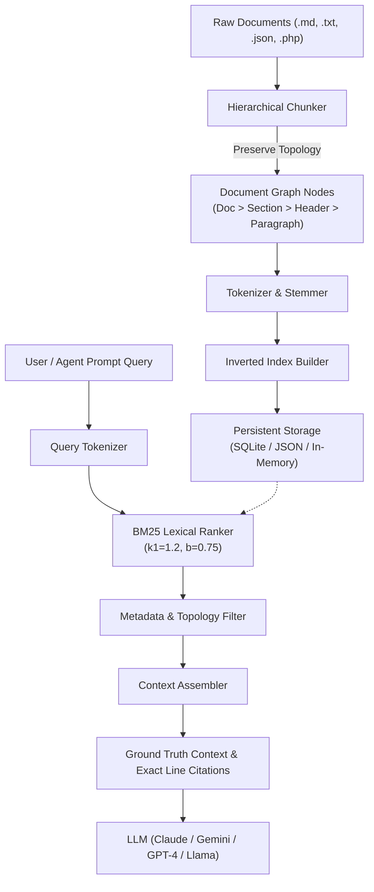

[🇸🇦 العربية](README.ar.md) | [🇬🇧 English](README.md)

# 📚 eidcloud-rag-vectorless

> Ultra-fast, zero-cloud-cost Vectorless RAG Engine using hierarchical document graphs, BM25 indexing, and structural metadata in pure PHP 8.2+.

[](https://github.com/eidcloud/eidcloud-rag-vectorless/releases)
[](https://www.php.net/)
[](LICENSE)
[](https://github.com/eidcloud/eidcloud-rag-vectorless/actions)
[](https://colab.research.google.com/github/eidcloud/eidcloud-rag-vectorless/blob/main/notebooks/quickstart.ipynb)

---

## ⚡ Overview

Traditional Retrieval-Augmented Generation (RAG) pipelines rely heavily on expensive GPU clusters, external embedding APIs (OpenAI, Cohere), and heavyweight vector databases (Pinecone, Milvus, Weaviate). This introduces network latency, recurring operational costs, API rate limits, and non-deterministic semantic drift.

**eidcloud-rag-vectorless** delivers an ultra-fast, zero-cloud-cost alternative built with **pure PHP 8.2+** with **zero external vendor dependencies**. By synthesizing **hierarchical document graph chunking**, **Robertson-Spärck Jones BM25 ranking**, and **exact citation metadata**, it achieves sub-millisecond retrieval with pinpoint line-level grounding for LLMs.

---

## 🏗️ Architecture & Retrieval Workflow



---

## 🚀 Key Capabilities

- **Zero Cloud Costs & No GPU Needed**: Run deterministic, high-precision retrieval on any standard CPU server, container, or edge instance without external embedding API fees.
- **Hierarchical Document Topology**: Chunks markdown and code along structural boundaries (`Document -> Section -> Header -> Paragraph`), retaining ancestor breadcrumbs and exact source line numbers.
- **Tuned BM25 Lexical Engine**: Implements term-frequency saturation ($k_1$), document-length normalization ($b$), and heading relevance boosting.
- **Line-Exact Citations**: Emits unambiguous citations (e.g. `docs/auth.md (lines 14-28) [Guide > Auth > Tokens]`) reducing LLM hallucinations.
- **Multi-Engine Persistence**: Instant in-memory search with high-speed persistent storage in SQLite or JSON inverted indexes.
- **AI Agent Context Injection**: Native `--json` output formatted specifically for programmatic consumption by LLM agent tool calls and pipelines.

---

## 📦 Installation

Ensure PHP 8.2+ is installed on your system.

```bash
git clone https://github.com/eidcloud/eidcloud-rag-vectorless.git
cd eidcloud-rag-vectorless
```

*(No `composer install` required—the library is 100% self-contained with zero third-party vendor dependencies).*

---

## 💻 CLI Usage

The bundled CLI tool `bin/eidcloud-rag` provides command-line indexing and querying:

### 1. Indexing Documents

Index an entire documentation directory or single file into an embedded SQLite database:

```bash
# Index directory into SQLite index
php bin/eidcloud-rag index ./docs/ --db=rag.sqlite

# Index into lightweight JSON file
php bin/eidcloud-rag index ./docs/ --db=rag.json
```

### 2. Searching & Context Generation

Query the indexed corpus and generate LLM context with citations:

```bash
# Query with exact line citations
php bin/eidcloud-rag ask "How does auth work?" --top=3 --citations

# Output clean JSON for AI agent context injection
php bin/eidcloud-rag ask "How does auth work?" --top=3 --json
```

### 3. CLI Options Reference

| Flag | Description | Default |
|------|-------------|---------|
| `--db=<path>` | Database storage path (`.sqlite` or `.json`) | `rag.sqlite` |
| `--top=<n>` | Number of ranked chunks to retrieve | `3` |
| `--citations` | Include exact file, line number, and hierarchy breadcrumbs | `false` |
| `--tag=<tag>` | Filter results by metadata tag | `none` |
| `--json` | Output structured JSON for AI pipelines | `false` |
| `-h, --help` | Display formatted help screen | - |

---

## 🧩 Programmatic PHP API

Use `RagEngine` directly in your PHP applications:

```php
<?php

use EidCloud\RagVectorless\RagEngine;

// 1. Initialize engine with SQLite persistence
$engine = RagEngine::createWithSqlite(__DIR__ . '/rag.sqlite');

// 2. Index documentation files
$engine->indexDirectory(__DIR__ . '/docs');

// 3. Retrieve ranked chunks for an agent query
$response = $engine->ask("How does JWT token rotation work?", topK: 3);

// 4. Inspect generated context & citations
echo $response['context_text'];

foreach ($response['citations'] as $citation) {
    echo "Citation: {$citation}\n";
}
```

---

## 🧪 Automated Testing

Run the zero-dependency test suite:

```bash
php tests/run_tests.php
```

Sample output:
```text
Running EidCloud Vectorless RAG Test Suite...

[1] Testing Tokenizer & Normalization
  ✔ PASS: Preserves domain keywords
  ✔ PASS: Preserves technical abbreviations
  ✔ PASS: Removes common English stop words
  ✔ PASS: Applies morphological stemmer (indexes -> index)

[2] Testing Hierarchical Document Chunking
  ✔ PASS: Creates nodes for sections and paragraphs
  ✔ PASS: Tracks accurate line numbers: line 4
  ✔ PASS: Preserves document topology breadcrumbs
  ✔ PASS: Captured paragraph under section hierarchy

[3] Testing BM25 Lexical Ranking
  ✔ PASS: Returns search matches
  ✔ PASS: BM25 ranks most relevant chunk first
  ✔ PASS: Score is positive and non-zero

[4] Testing SQLite Inverted Index Persistence
  ✔ PASS: SQLite database file created on disk
  ✔ PASS: Retrieved results from persisted SQLite database
  ✔ PASS: Loaded node content accurately

[5] Testing JSON Inverted Index Persistence
  ✔ PASS: JSON database file created on disk
  ✔ PASS: Retrieved results from persisted JSON storage
  ✔ PASS: Matched correct cached chunk

[6] Testing Context Assembly & Exact Citations
  ✔ PASS: Generated citations list
  ✔ PASS: Citation includes accurate file path
  ✔ PASS: Citation includes line numbers
  ✔ PASS: Context block formatted with source markers

[7] Testing Metadata Filtering
  ✔ PASS: Unfiltered query returns all matches
  ✔ PASS: Filter returns only matching env
  ✔ PASS: Matched docA with prod env

============================================================
Results: 24 assertions, 0 failures (100% PASS)
```

---

## 👨‍💻 Author & Maintainer

**Eng. MHD. Shadi AL-Hasan**  
Email: [mhd.shadi.alhasan@gmail.com](mailto:mhd.shadi.alhasan@gmail.com)  
Project: [EidCloud Architecture & Core Services](https://github.com/eidcloud)

---

## 📄 License

This project is licensed under the MIT License - see the [LICENSE](LICENSE) file for details.
Copyright (c) 2026 MHD. Shadi AL-Hasan.

---

## 👤 Author & Maintainer

**Eng. MHD. Shadi AL-Hasan**  
- **Role:** Executive CTO & Enterprise Solutions Architect  
- **Email:** [mhd.shadi.alhasan@gmail.com](mailto:mhd.shadi.alhasan@gmail.com)  
- **Phone / WhatsApp:** [+963934005922](tel:+963934005922)  
- **Location:** Damascus, Syria  
- **GitHub:** [shadialhasan](https://github.com/shadialhasan)  

---

## 📄 License

This project is licensed under the MIT License - see the [LICENSE](LICENSE) file for details.  
Copyright (c) 2026 **MHD. Shadi AL-Hasan**. All rights reserved.
